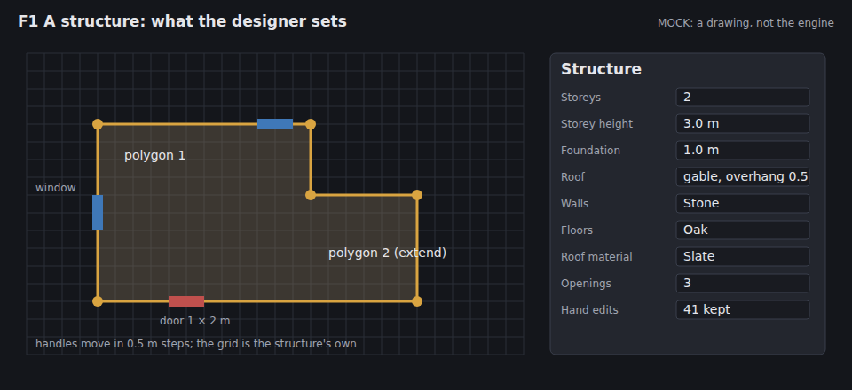
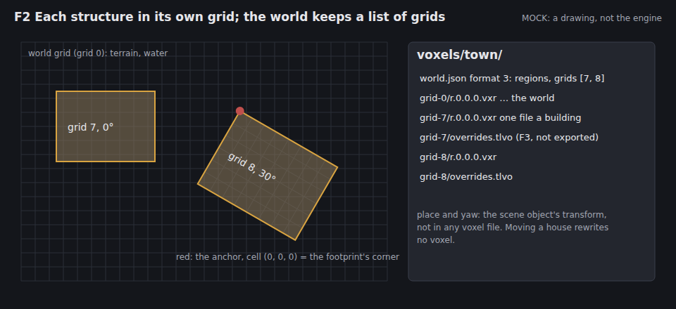
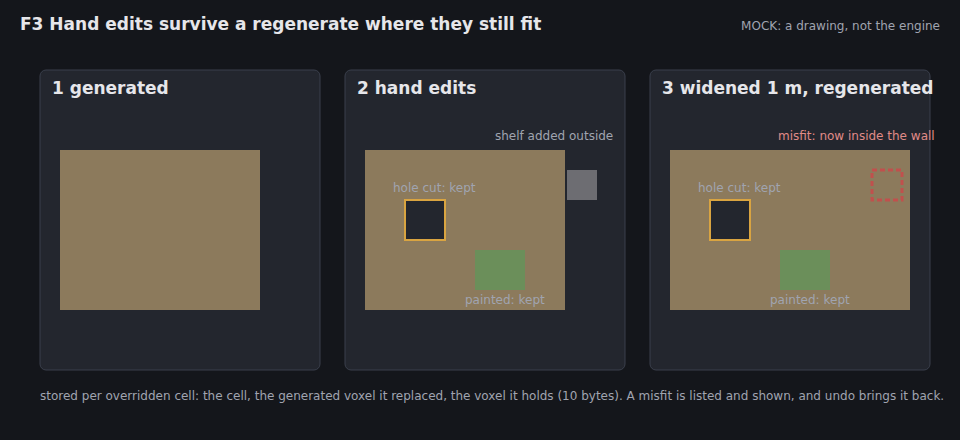
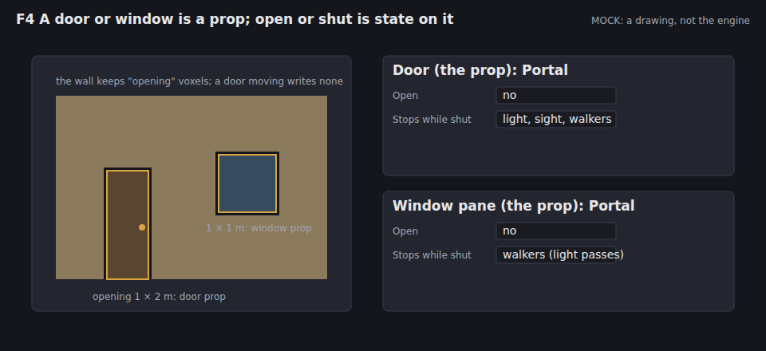
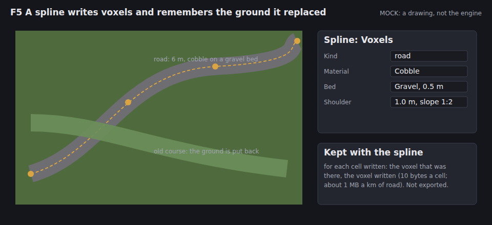
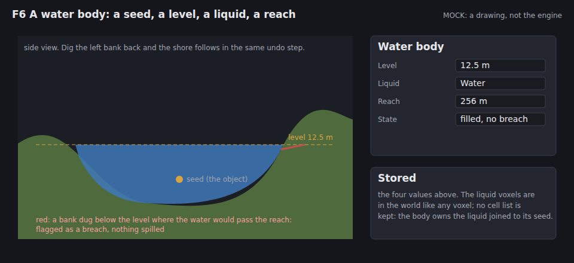
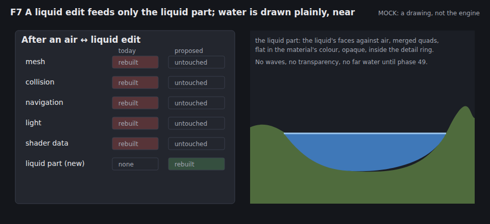

# 47a — what structures and water bodies store: seven proposed entries (owner's note needed on each)

**Status: proposed 2026-11-20. Nothing is built.** Each entry below is add-only: it adds a field, a component or a
file; it changes nothing an existing project, region file, save or export holds. Answer each with **yes / no /
change**. An item that needs an entry waits for its note (`docs/plan-phase-47a.md` §6, §8); the others go on.

What does **not** change in any entry: the voxel value (32 bits), the chunk codec, the region file's bytes, the
edit command, the undo record, the save file, the far cache, the kit, role and render specs.

Two rules hold for all seven:

- **Voxels stay the single source of truth.** A definition writes voxels; the game, the light, collision and
  exports read the voxels and never the definition.
- **Definitions are authoring data.** They live in the project and are left out of exports (R35), with their
  overrides.

---

## F1 — the structure record (a building's definition)



**What a designer sets** (the Inspector and the handles in the Scene view):

- the **footprint**: one or more polygons with right-angled corners on the structure's 0.5 m grid (a second
  polygon makes an L, a T or a wing);
- **storeys** (a count) and the **storey height** (in cells; default 6 = 3 m: a 2.5 m room under a floor);
- the **foundation's depth** below the ground floor (cells; default 2 = 1 m);
- the **roof**: flat, gable or hip, its overhang and, for a gable, its ridge direction;
- **materials**, one a part: walls, floors, roof, foundation, stairs (voxel materials; a material's kit draws it);
- **openings**: each on a wall of a polygon at a storey, with its place along the wall, its width and height in
  0.5 m steps, its sill height, and its prop (F4);
- **stairs**: where a flight joins two storeys.

**What is stored:** one component, `voxelStructure`, on a scene object in the scene of its voxel world:

```
voxelStructure: {
  world: "<the voxel world's name>",
  grid: 7,                                   // its grid id in that world (F2)
  footprint: [ { id, points: [[x, z], …] }, … ],        // cells, in the structure's grid
  storeys: 2, storeyHeight: 6, foundationDepth: 2,
  roof: { shape: "gable", overhang: 1, axis: "x" },
  materials: { wall, floor, roof, foundation, stair },   // voxel material ids
  openings: [ { id, polygon, edge, storey, at, width, height, sill, prop? }, … ],
  stairs: [ { id, polygon, from, at, facing } ],
  generator: 1                               // the generator's version that last wrote the voxels (R34)
}
```

- The voxels are a pure function of this record (R30). Changing a field regenerates them, as one undo step with
  the field's change.
- A **material swap** rewrites material ids only (R31); **scale** moves polygon points in whole cells; **drag up**
  adds 1 to `storeys`; **extend** adds a polygon; **copy and paste** copies the object, its grid and its overrides.
- `generator` is not a pin: a newer engine regenerates every structure in one undoable "regenerate all" step and
  reports the misfits (R34). The number only tells the editor that step is due.
- No count caps: polygons, storeys and openings are lists.

**Not in the entry:** curved or diagonal walls (a diagonal wall is a second structure at another yaw, as decided
in plan 45 §1e); interiors and furnishing; roof kinds beyond the three (added later as values).

---

## F2 — a structure's own grid: where it is stored and how it is placed



**What a designer sets:** nothing new. They move and turn the structure object like any object; the editor keeps
its turn about the vertical axis only (floors stay level) and its place as it is put.

**What is stored:**

- **The transform** is the object's own position and yaw in the scene (no second copy in the voxel files, as spec
  §2.1 already says). Moving a structure rewrites no voxel.
- **The voxels** are region files of the same format as the world's, in the world's folder under
  `grid-<id>/` (spec §3.2 already reserves this; the header already carries the grid id).
- **The world manifest gains one field** (`world.json`, format 2 → 3, lifted by an add-only step):
  `grids: [ { id: 7, regions: ["r.0.0.0.vxr"] }, … ]`, sorted by id; a grid's regions listed as the world grid's
  are, so a missing file is damage and never air (R4). Format 2 worlds read as having no structure grids.
- **The anchor rule:** a structure's cell (0, 0, 0) is the minimum corner of its footprint's box at the ground
  floor's top, so a building under 256 m is one region file (the proposal of 45.3: test houses were 4 files each
  when they straddled cell 0).
- **Exports** ship each grid's region files and a list of grids with their transforms in the runtime manifest
  (R39: never resampled into the world grid).

**Not in the entry:** a tilt or a scale of a grid (never); two structures sharing one grid.

---

## F3 — overrides: hand edits kept over what the generator makes



**What a designer does:** digs, adds or paints on a structure. After any later change of the definition their
edits are still there where they still fit; the ones that do not fit are listed and shown, never dropped in
silence.

**What is stored:** the format the spec already holds as a draft (§3.5, `TLVO` version 2: a cell, the generated
voxel it replaced, the voxel it holds; 10 bytes a cell, by chunk, checksummed). The proposal is only to **use it
as written**:

- its file is `voxels/<world>/grid-<id>/overrides.tlvo`, written in the same staged write as the grid's region
  files; never exported;
- the **fit rule** stays the spec's: absorbed (the generator now makes it), kept (the same kind of voxel is
  generated under it: both air, or the same role), misfit (reported with its place, not written; the regenerate's
  undo brings it back);
- `format-versions.md`: "structure overrides 2 (draft)" becomes "2".

---

## F4 — opening props and portal state (doors, windows, shutters)



**What a designer sets:**

- on an **opening** (F1): its prop, a model or prefab from the project; left empty, the editor offers the
  project's props that fit the opening's size;
- on the **prop**: whether it starts open or shut, and what it stops while shut: light, sight (see-through and
  rooms), walkers.

**What is stored:** one component on the prop object, `voxelPortal`:

```
voxelPortal: { open: false, stops: { light: true, sight: true, walk: true } }
```

- The prop stands in its opening as a child of the structure object; the opening's record names it (`prop`).
- **Open or shut is state, not voxels** (R45): the opening's cells stay `opening` voxels. While shut and stopping
  light, the portal's cells stop the light's rays whole and at once, whatever the leaf's thickness; open, they
  pass it. A pane of glass is a prop with `stops.light: false`.
- A game's script flips it (`open` through the generic component access); a game saves it as it saves any
  component state. The engine has no door behaviour: how a door swings or who may open it is the game's.

**Not in the entry:** a share of light passed (a pane at 80 %, a shutter at 30 %): that is D741's question.

---

## F5 — splines that write voxels, and what a world-grid structure replaced



**What a designer sets**, on the `spline` component they already have (points with widths):

```
voxels: {
  kind: "road" | "path" | "river",
  material,                      // the surface (road, path) or the liquid (river)
  bed?: { material, depth },     // what lies under a road; a river's bed material and depth
  shoulder?: { width, slope },   // how the sides meet the ground
  clear?: height                 // air cleared above (a road through a hill)
}
```

A per-point width already exists; a river's surface follows the spline's height.

**What is stored:**

- the `voxels` section above (add-only on the spline; the heightfield `terrain` section is untouched and retires
  with heightfield terrain in 48);
- **the record of what it replaced.** A road in the world grid overwrites ground. To move the road and get the
  ground back, the structure keeps, for every cell it wrote, the voxel that was there and the voxel it wrote: the
  same `TLVO` layout as F3 with its two values read as "before" and "written", in
  `voxels/<world>/structures/<object id>.tlvo`. Moving the spline puts "before" back wherever the cell still holds
  what was written (a cell someone edited since is left alone and reported), then writes the new course.
  Authoring data: never exported. Size: 10 bytes a cell written, before compression (a 1 km road 6 m wide and 2 m
  deep is about 96,000 cells: under 1 MB).

This record is what makes a spline a *regenerated* structure and not a one-way stamp. Without it a moved road
leaves its old cut in the ground.

---

## F6 — the water body record



**What a designer sets**, on an object placed in the water:

- the **seed**: the object's own position (a point inside the basin);
- the **level**: a height in metres (a handle in the Scene view);
- the **liquid material**;
- the **reach**: how far from the seed the body may spread (metres; default 256). It is the bound: water that
  would pass it is a breach.

**What is stored:** one component, `waterBody`:

```
waterBody: { world: "<name>", level: 12.5, material: <liquid material id>, reach: 256 }
```

- The body's liquid voxels are written by the level fill: from the seed through every non-solid cell below the
  level, bounded by solid voxels and by the reach; the top cells take the partial fill (16 levels).
- **A body owns the liquid of its material connected to its seed.** Regenerating clears that liquid and fills
  again, so no cell list is stored. Liquid painted by hand against a body becomes part of it.
- **In the editor**, a ground edit or a structure regenerated inside a body's reach writes the body again in the
  same undo step (ground → buildings → water, R41): dig a bank back and the shore follows.
- **A breach** (the fill reaches the reach's edge or leaves the loaded world below the level) writes nothing
  past the bound and is flagged: a warning on the object and a marker where it leaks. The flag is reported, not
  stored.
- Exports ship the liquid voxels; the record is authoring data. At run time nothing regenerates (the later
  settle of phase 49 would call the same fill).

---

## F7 — narrowed feeds for liquid edits, and the liquid part



**What a designer notices:** water appears where liquid voxels are (today nothing draws them), flat and in the
liquid material's colour, inside the detail ring; and editing water no longer rebuilds the ground's mesh,
collision, paths and light round it.

**What changes in the spec** (nothing stored; derived data is never stored):

- **The feeds table** (spec §2.2) gains a row and a rule:

  | Change | Feeds |
  |---|---|
  | a cell changing only between air and liquid, or a liquid's fill level or material | the **liquid part** alone |

  Today such a change is a change of role and shape and feeds mesh, collision, nav, light and shader data,
  though liquid is open to all five. Any change that touches a non-liquid role feeds what it feeds today.
- **A new derived part, `liquid`** (spec §3.7, a derived version step): a chunk's liquid faces against air (its
  surface at the fill's height and its sides where water stands against air), merged into quads, with the
  material. Built in the derive job, cached with the chunk's other parts, drawn by a plain unlit-water material
  (the material's colour, lit by the sun and the light volume as any surface, opaque).

Phase 49 extends this part (column runs, flow, shore distance) and replaces the look; the register's line "a
liquid derived part per chunk (49)" is this part, begun here in its plainest form.

**Not in the entry:** water past the detail ring (the far cache's liquid channel, 49); waves, transparency,
refraction, foam; swimming or buoyancy.
